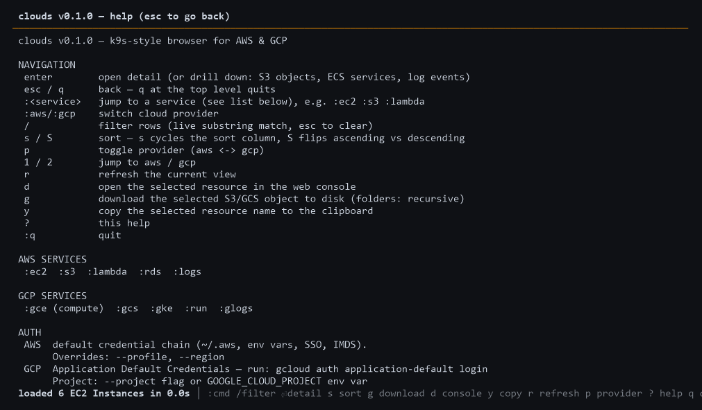
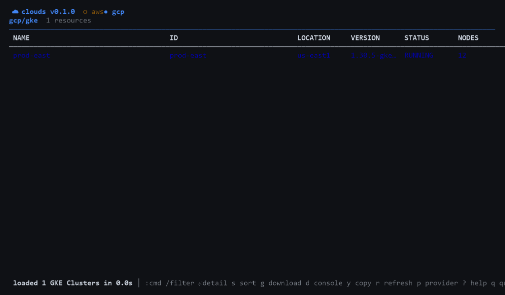
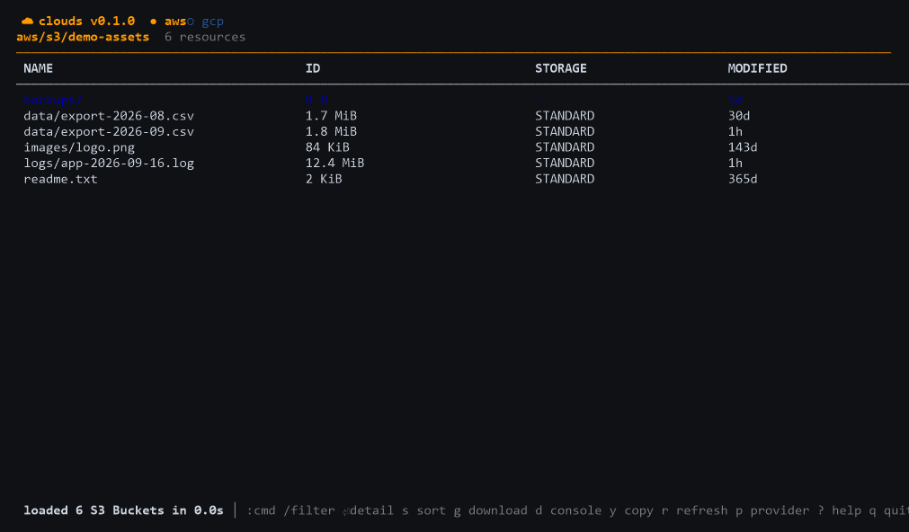

# clouds

**A k9s-style terminal UI for AWS and GCP, shipped as a single static binary.**

Like [k9s](https://k9scli.io/) does for Kubernetes, `clouds` gives you a fast,
keyboard-driven view of your cloud accounts without leaving the terminal: jump
between services with `:commands`, filter and sort live, drill into child
resources, download objects, and open the web console for whatever is under the
cursor.

Built with [Bubble Tea](https://github.com/charmbracelet/bubbletea),
[aws-sdk-go-v2](https://github.com/aws/aws-sdk-go-v2) and
[google.golang.org/api](https://github.com/googleapis/google-api-go-client).
No venv, no pip, no runtime dependencies — build once, run anywhere.


## Contents

- [Quick start](#quick-start)
- [Keys](#keys)
- [The command bar](#the-command-bar)
- [Services](#services)
- [Downloading objects](#downloading-objects)
- [Configuration](#configuration)
- [Authentication](#authentication)
- [Building from source](#building-from-source)
- [Releases](#releases)
- [Troubleshooting](#troubleshooting)
- [Project layout](#project-layout)
- [Roadmap](#roadmap)

## Quick start

### Try it first — no credentials, no network

```bash
clouds --demo
```

Runs the whole UI against a built-in sample catalog (a representative subset of
AWS and GCP services, with sample rows and downloadable fake objects). It is the
fastest way to see whether this tool is for you.

### Install a release

Substitute your GitHub account for `GITHUB_REPO` below (or set `CLOUDS_REPO`;
see the table further down).

```bash
# macOS / Linux — installs to ~/.local/bin, verifies the SHA256 checksum:
curl -fsSL https://raw.githubusercontent.com/GITHUB_REPO/clouds/main/scripts/install.sh | bash

# Windows (PowerShell) — installs to %LOCALAPPDATA%\Programs\clouds:
irm https://raw.githubusercontent.com/GITHUB_REPO/clouds/main/scripts/install.ps1 | iex
```

Both installers read the newest release from GitHub unless you pin one. On
Linux the installer also installs a desktop entry, so `clouds` shows up in the
applications menu (skip with `CLOUDS_NO_DESKTOP=1`).

| Variable | Effect |
|----------|--------|
| `CLOUDS_VERSION` | Pin a release, e.g. `v0.2.0` (default: `latest`) |
| `CLOUDS_BIN` | Install directory (default: `~/.local/bin`, or `%LOCALAPPDATA%\Programs\clouds` on Windows) |
| `CLOUDS_REPO` | Install from a fork, e.g. `you/clouds` |

Prefer a package manager? Scoop and Homebrew manifests live in
[`packaging/`](packaging/README.md).

### Run it

```bash
clouds                                   # browse with your default credentials
clouds --demo                            # sample data
clouds --profile prod --region us-west-2
clouds --project my-gcp-project
clouds --list-services                   # print every service shortcut
clouds --version
```

> Use a modern terminal — Windows Terminal, iTerm2, or any current Linux/BSD
> terminal. Legacy consoles render the table poorly.

## Keys

| Key | Action |
|-----|--------|
| `:` | command bar — `:ec2`, `:s3`, `:gcp`, `:q`, … |
| `/` | filter rows (live substring match; `esc` clears) |
| `s` / `S` | sort — `s` cycles the sort column, `S` flips ascending/descending |
| `enter` | open the detail view, or drill down (S3 bucket → objects, ECS cluster → services, log group → recent events) |
| `esc` / `q` | back — `q` at the top level quits |
| `p` | toggle provider (aws ⇄ gcp) |
| `1` / `2` | jump straight to aws / gcp |
| `r` | refresh the current view |
| `d` | open the selected resource in the web console |
| `g` | download the selected S3/GCS object (folder markers: recursive) |
| `y` | copy the selected resource name to the clipboard |
| `?` | help |
| arrows / pgup / pgdn / mouse | navigate and scroll |

Views you come back to within **45 seconds** replay from an in-memory cache —
the status bar says so, and `r` always refetches.



## The command bar

Type `:` then a service id. Beyond the services, the command bar accepts:

| Command | Effect |
|---------|--------|
| `:q` / `:quit` / `:exit` | quit |
| `:?` / `:help` | help screen |
| `:aws` / `:gcp` | switch provider, returning to the last service you viewed there |

Service commands are resolved against the provider you are currently in, then
the other one — so `:ec2` works even while you are looking at GCP. Where an
alias exists in both clouds it follows the current provider: `:log` means
CloudWatch Logs under AWS and Cloud Logging under GCP. The explicit ids
(`:logs`, `:glogs`) are always unambiguous.

## Services

| AWS (aws-sdk-go-v2) | GCP (google.golang.org/api) |
|---------------------|------------------------------|
| `:ec2` instances | `:gce` Compute Engine VMs (`:compute`) |
| `:s3` buckets → objects (downloadable) | `:gcs` buckets → objects (downloadable) |
| `:lambda` functions | `:gke` clusters |
| `:rds` instances | `:run` Cloud Run services |
| `:logs` log groups → recent events (`:log`) | `:fn` Cloud Functions (`:functions`) |
| `:ecs` clusters → services | `:bq` BigQuery datasets |
| `:eks` clusters | `:pubsub` Pub/Sub topics |
| `:sqs` queues (with message counts) | `:sql` Cloud SQL instances |
| `:dynamodb` tables (`:ddb`) | `:glogs` Cloud Logging, last 6h (`:log`) |

`clouds --list-services` prints this list from the live catalog, so it can never
drift from what the binary actually supports.

Multi-region AWS scans (`--all-regions`) apply to the regional services — EC2,
Lambda, RDS, CloudWatch Logs, ECS, EKS, SQS and DynamoDB. S3 is account-global
and unaffected.



## Downloading objects

Press `g` on an S3 or GCS object row:

- **Single objects** stream to disk with live progress in the status bar
  (`4.2 MiB / 12.4 MiB  logs/app.log`, updated about seven times a second).
- **Folder markers** (keys ending in `/`, as the S3 console creates) download
  recursively — everything under that prefix, up to 200 files.
- Files land in `~/Downloads/clouds/<bucket>/<key>`, preserving the key
  structure. Override with `--download-dir` or the config file.
- Object keys are sanitized — `..`, `.` and colon-bearing path segments are
  dropped — so a hostile key cannot write outside the download directory.
- Works in `--demo` mode too: it writes small sample files so the whole flow can
  be exercised without a cloud account.



## Configuration

### Flags

| Flag | Meaning |
|------|---------|
| `--profile` | AWS shared-config profile (default: the AWS default credential chain) |
| `--region` | AWS region override |
| `--project` | GCP project override |
| `--download-dir` | Where `g` writes (default: `~/Downloads/clouds`) |
| `--demo` | Explore built-in sample data |
| `--all-regions` | AWS: scan every enabled region instead of just the configured one |
| `--config` | Load a specific config file instead of the default one |
| `--list-services` | Print providers/services and exit |
| `--version` | Print version, commit and build date, then exit |

### Config file

Skip repeating flags by writing a config file at
`os.UserConfigDir()/clouds/config`, or point at another file with
`--config <path>`:

| Platform | Path |
|----------|------|
| Linux / BSD | `~/.config/clouds/config` |
| macOS | `~/Library/Application Support/clouds/config` |
| Windows | `%AppData%\clouds\config` |

```ini
# clouds config — explicit flags always win over these values
profile = prod
region = us-west-2
project = my-gcp-project
download-dir = /data/s3
all-regions = false
demo = false
```

Lines starting with `#` or `;` are comments. Booleans accept
`1`/`true`/`yes`/`on`. Precedence is: **explicit flag → config file → built-in
default**, and a flag counts as explicit only when you actually passed it — so
`--demo=false` on the command line overrides `demo = true` in the file.

### Limits worth knowing

| Limit | Value |
|-------|-------|
| Rows fetched per view | 1000 |
| S3 buckets listed (and files per recursive download) | 200 |
| Default fetch timeout | 90s |
| Fetch timeout with `--all-regions` | 5 minutes |
| Cached-view reuse | 45s |

`--all-regions` discovers the regions enabled for the account
(`ec2:DescribeRegions`) and scans six at a time. It is best-effort: regions that
error are skipped, and it only fails if every region does. Rows are sorted
afterwards, so the result is deterministic despite the parallel fan-out.

## Authentication

| Cloud | Credentials | Project / region |
|-------|-------------|------------------|
| AWS | Standard credential chain: `aws configure`, `aws sso login`, environment variables, or an instance role | `--profile` / `--region`, or `AWS_PROFILE` |
| GCP | Application Default Credentials: `gcloud auth application-default login` | `--project` or `GOOGLE_CLOUD_PROJECT` |

`clouds` stores no credentials of its own — it reads the standard SDK chains on
every run. AWS identity is resolved once at start-up
(`sts:GetCallerIdentity`) and shown in the top bar as
`profile=… account=… region=…`; with `--all-regions` the region reads `all`.

## Building from source

Requires **Go 1.25 or newer** (the version pinned in `go.mod`) — only to build.
The resulting binary has no runtime dependencies.

```bash
git clone https://github.com/GITHUB_REPO/clouds.git
cd clouds
go build -trimpath -ldflags "-s -w" -o clouds .
./clouds --demo
```

`scripts/run.sh` and `scripts\run.bat` do the same thing and launch
automatically if the binary is missing.

### The Windows icon

Windows builds embed the app icon from a generated resource object. The release
scripts handle it; to do it for a local build:

```powershell
go run ./packaging ico packaging/icons   # packaging/icons/clouds.ico
go run ./packaging syso -arch amd64      # clouds_windows_amd64.syso in the project root
go build -trimpath -ldflags "-s -w" -o clouds.exe .
```

The `.syso` must sit in the project root — that is the main package directory,
and it is where `go build` looks for resources to link in. The file name's
`windows_<arch>` suffix is honoured by the Go toolchain, so the amd64 and arm64
objects coexist and each is linked only into its own target. Both the icon set
and the `.syso` files are build products and are gitignored.

## Releases

Every push runs `go vet`, `go build` and `go test` in CI; pushing a `v*` tag
publishes the full matrix to a GitHub Release.

```bash
git tag v0.2.0 && git push origin v0.2.0     # CI builds and publishes
```

To build the same artifact set locally:

```bash
./scripts/release.sh v0.2.0     # macOS / Linux / Git Bash
scripts\release.bat v0.2.0      # Windows
```

Everything lands in `release/`:

| File | Runs on |
|------|---------|
| `cloud-darwin-amd64`, `cloud-darwin-arm64` | Intel and Apple Silicon Macs |
| `cloud-darwin-*-app.zip` | macOS `.app` bundles (icon + Info.plist); unsigned, so right-click → *Open* the first time |
| `cloud-linux-amd64`, `cloud-linux-arm64` | 64-bit x86 and ARM64 Linux |
| `cloud-linux-arm` | 32-bit ARM Linux (Raspberry Pi 2/3/4) |
| `cloud-windows-amd64.exe`, `cloud-windows-arm64.exe` | x64 and ARM64 Windows, with the app icon embedded |
| `cloud-<os>-<arch>.tar.gz` / `.zip` | Compressed siblings for distribution (Go binaries shrink ~65–70%) |
| `SHA256SUMS` | Checksums covering the binaries and the archives |

Every binary is stamped with the version, commit and build date, so
`clouds --version` reports e.g. `clouds v0.2.0 (a1b2c3d, built 2026-09-25)`.
With no version argument the release scripts take the newest `v*` git tag,
falling back to the `0.1.0` baked into `ui/styles.go`.

Verify a downloaded release the same way the installers do:

```bash
sha256sum -c SHA256SUMS    # or: shasum -a 256 -c SHA256SUMS
```

Two more details the scripts take care of on your behalf:

- **Desktop integration.** They regenerate the icon set, `clouds.ico` and the
  per-architecture `.syso` objects first (`go run ./packaging …`). macOS gets
  real `.app` bundles with an `.icns`; Linux tarballs carry `clouds.desktop`
  plus an SVG icon, which `install.sh` installs into the applications menu.
- **Manifests.** After a release, refresh `packaging/clouds.json` (Scoop) and
  `packaging/clouds.rb` (Homebrew) from the new `SHA256SUMS` — the workflow is
  described in [`packaging/README.md`](packaging/README.md).


## Troubleshooting

| Symptom | Fix |
|---------|-----|
| AWS `Unable to locate credentials` | Run `aws configure`, or `aws sso login` for SSO |
| GCP `no GCP project` | Pass `--project` or set `GOOGLE_CLOUD_PROJECT` |
| GCP auth errors | `gcloud auth application-default login`, then retry |
| `y` does nothing on Linux | Clipboard needs `wl-copy` (Wayland), `xclip` or `xsel` installed |
| Garbled or uncoloured output | Use a 256-colour terminal — Windows Terminal, iTerm2, or a modern Linux terminal |
| `go` not found | Install from https://go.dev/dl, or via `winget` / `apt` / `brew` |
| An empty view where you expected rows | Some services return nothing without a region, project or permission; check the status line for the error, and `--all-regions` for regional AWS services |

## Project layout

| Path | What lives there |
|------|------------------|
| `main.go` | Flags, config merge, `--list-services`, launches the TUI |
| `cloud/types.go` | The data model: `Resource`, `Service`, `Provider`, download-path safety, parallel fetch helper |
| `cloud/config.go` | The optional `key = value` config file |
| `providers/aws.go` | aws-sdk-go-v2 services: pagination, `--all-regions` fan-out, S3 downloads |
| `providers/gcp.go` | `google.golang.org/api` services, including GCS downloads |
| `providers/demo.go` | Built-in sample data for `--demo` |
| `ui/model.go` | Bubble Tea model: table, filter, command bar, drill-down stack, view cache |
| `ui/styles.go` | lipgloss theme, provider accents, version variables |
| `ui/clipboard.go` | Platform clipboard and browser helpers |
| `packaging/` | Icon generation (`.png`/`.icns`/`.ico`/`.syso`) and the macOS `.app` bundler, plus Scoop/Homebrew manifests |
| `scripts/` | `run`, `build`, `release` and the one-line installers |
| `.github/workflows/ci.yml` | vet/build/test on every push; release on `v*` tags |

Design principles, mirroring k9s:

- **Everything is a `Resource` table** — services return rows, the UI is generic.
- **Drill-down is just another fetch** — `Resource.Sub` lazily loads children onto the nav stack.
- **API calls never block the UI** — every fetch runs on a goroutine and stale results are dropped.
- **Providers are pluggable** — adding a service means appending a `cloud.Service` to a catalog.

## Roadmap

- SSH/SSM into EC2 and `gcloud compute ssh` from the resource view
- Log tailing (live follow) for CloudWatch and Cloud Logging
- Resource mutations (start/stop EC2, restart Cloud Run)
- An Azure provider
- Saved views and bookmarks, YAML export

## Related

- [`packaging/README.md`](packaging/README.md) — Scoop and Homebrew distribution
